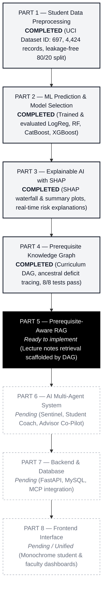

# AI-Powered Agentic Smart Campus Intelligence & Student Success Platform

**Part 1: Student Data Preprocessing & Validation**  
**Part 2: Machine Learning Student Risk Modeling & Model Selection**  
**Part 3: Model Explainability with SHAP (SHapley Additive exPlanations)**  
**Part 4: Curriculum Prerequisite Knowledge Graph & Cognitive Deficit Diagnosis**  

* **Author:** Sumith U (SRN: `R24EA807`) | Section B  
* **Degree Program:** B.Tech in Computer Science & Engineering (Artificial Intelligence & Machine Learning) - 7th Semester  
* **Institution:** School of Computing & Information Technology, REVA University, Bengaluru  
* **Primary Reference Corpus:** UCI Machine Learning Repository (Dataset ID: 697, 4,424 records) & REVA Capstone Specification  

---

## 1. Project Roadmap Progress



---

## 2. Overview of Part 4 (Prerequisite Knowledge Graph & Cognitive Deficit Tracing)

Following [`Part4_Prerequisite_Knowledge_Graph_Workflow.pdf`](file:///c:/Users/sumit/Downloads/rio/Part4_Prerequisite_Knowledge_Graph_Workflow.pdf), Part 4 implements a Directed Acyclic Graph (DAG) using NetworkX to identify unmastered foundational concepts:

1. **Curriculum Knowledge Representation:**
   * 17 academic concepts spanning mathematical foundations, classical ML, deep neural networks, and explainable AI.
   * 21 directed prerequisite edges enforcing $u \to v$ (concept $u$ must be understood before concept $v$).
2. **DAG Integrity & Topological Sorting:**
   * Strictly verified as acyclic (0 cycles).
   * Generates a globally valid pedagogical sequence using topological sorting.
3. **Canonical Curriculum Pathway Verification:**
   * Explicitly validates the sequence from the specification:  
     $$\text{Partial Derivatives} \longrightarrow \text{Chain Rule} \longrightarrow \text{Backpropagation} \longrightarrow \text{Neural Network Training}$$
4. **Formative Assessment Evidence Mapping:**
   * Maps student quiz scores to concepts using a non-punitive threshold ($\tau = 0.60$).
   * Treats low scores as opportunities for reinforcement rather than fixed labels of student ability.
5. **Ancestral Deficit Tracing:**
   * Given a target concept, computes the transitive ancestral closure of prerequisites.
   * Isolates causal bottlenecks while filtering out unrelated weak topics (e.g., isolating calculus gaps for neural networks while filtering out decision trees).
6. **Downstream Integration Interfaces:**
   * Structured RAG retrieval plans for Part 5 (retrieves prerequisite slides before target slides).
   * Pedagogical payloads for the Part 6 AI Student Coach.

---

## 3. Directory Structure & File Manifest

```text
student_success_platform/
├── data/
│   ├── raw/
│   │   └── data.csv                      # Original untouched UCI dataset (4,424 rows)
│   ├── processed/
│   │   ├── X_train.csv                   # Leakage-free training features (3,539 rows)
│   │   ├── X_test.csv                    # Leakage-free testing features (885 rows)
│   │   ├── y_train_binary.csv            # Binary targets (0: Persistent, 1: Dropout)
│   │   ├── y_test_binary.csv
│   │   ├── y_train_multiclass.csv        # 3-class targets (Dropout, Enrolled, Graduate)
│   │   └── y_test_multiclass.csv
│   └── concept_prerequisites.json        # Part 4: Curriculum concepts & prerequisite edges
│
├── models/
│   ├── selected_model_pipeline.joblib   # Serialized production model pipeline
│   └── model_metadata.json              # Hyperparameters, metrics, and thresholds
│
├── notebooks/
│   ├── 01_student_data_eda.ipynb         # Part 1: Exploratory data analysis
│   ├── 02_student_risk_modeling.ipynb    # Part 2: 4-algorithm ML benchmark
│   ├── 03_model_explainability_shap.ipynb# Part 3: Global & local SHAP diagnostics
│   └── 04_prerequisite_knowledge_graph.ipynb # Part 4: Interactive DAG & gap tracing
│
├── reports/
│   ├── data_quality_report.md           # Part 1: Validation findings
│   ├── feature_leakage_documentation.md # Part 1: Temporal leakage prevention
│   ├── model_comparison.md              # Part 2: Performance benchmark tables
│   ├── shap_explanation_report.md       # Part 3: Empirical feature attribution
│   ├── prerequisite_graph_report.md     # Part 4: Graph metrics & deficit tracing
│   └── figures/
│       ├── target_distribution.png
│       ├── correlation_heatmap.png
│       ├── confusion_matrix.png
│       ├── roc_curves.png
│       ├── shap_global_summary.png
│       ├── shap_global_importance.png
│       ├── shap_student_case_waterfall.png
│       └── prerequisite_knowledge_graph.png # Part 4: Visual DAG diagram
│
├── src/
│   ├── data_loader.py                   # Part 1: Dataset ingestion
│   ├── data_validation.py               # Part 1: Integrity assertions
│   ├── preprocessing.py                 # Part 1: Anti-leakage pipeline
│   ├── train_models.py                  # Part 2: Logistic Regression, RF, CatBoost, XGBoost
│   ├── explain_model.py                 # Part 3: SHAP explainer & real-time advisor
│   └── prerequisite_graph.py            # Part 4: NetworkX DiGraph, queries, gap tracer
│
├── tests/
│   └── test_prerequisite_graph.py       # Part 4: Rigorous unit test suite
│
├── run_step1_tests.py                   # Automated test runner (Part 1: 7/7 pass)
├── run_part2_tests.py                   # Automated test runner (Part 2: 6/6 pass)
├── run_part3_tests.py                   # Automated test runner (Part 3: 5/5 pass)
├── run_part4_tests.py                   # Automated test runner (Part 4: 8/8 pass)
├── requirements.txt                     # Pinned project dependencies
└── README.md                            # Comprehensive platform documentation
```

---

## 4. Execution & Testing Guide

All parts feature 1-command automated test runners that can be executed directly from your terminal:

### Test Part 1: Student Data Preprocessing & Validation
```powershell
cd student_success_platform
python run_step1_tests.py
```

### Test Part 2: ML Student Risk Modeling & Benchmark
```powershell
python run_part2_tests.py
```

### Test Part 3: Model Explainability with SHAP
```powershell
python run_part3_tests.py
```

### Test Part 4: Prerequisite Knowledge Graph & Deficit Tracing
```powershell
python run_part4_tests.py
```

### Test Local Docker Databases, Fluxbase Cloud & Flux AI Models
```powershell
python run_db_tests.py
```

### Test Role-Separated API Endpoints (Student & Faculty)
```powershell
python -m unittest tests/test_api_endpoints.py
```

### Run the Standalone Prerequisite Graph Script
To inspect the DAG properties, verify the learning sequence, and generate the diagram:
```powershell
python src/prerequisite_graph.py
```

### Run the Subject-Scoped Intelligent RAG Engine Demo
```powershell
python src/subject_rag_engine.py
```

### Run the Standalone ChromaDB Vector Search Demo
```powershell
python src/vector_db_manager.py
```

### Run the Standalone Fluxbase Database & AI Gateway Demo
```powershell
python src/fluxbase_client.py
python src/flux_ai_service.py
```

### Start the REST API Backend Server (FastAPI)
```powershell
python src/api_server.py
```
* Interactive Swagger API Docs: **http://localhost:8002/docs**
* ReDoc Alternative Docs: **http://localhost:8002/redoc**

---

## 5. Summary of Verified Test Suites

| Part | Component | Test Runner | Tests Passed | Status |
| :---: | :--- | :--- | :---: | :---: |
| **Part 1** | Data Cleaning & Leakage-Free Preprocessing | `run_step1_tests.py` | **7 / 7** | **Verified** |
| **Part 2** | Machine Learning Risk Modeling (LogReg selected) | `run_part2_tests.py` | **6 / 6** | **Verified** |
| **Part 3** | SHAP Global & Local Attribution | `run_part3_tests.py` | **5 / 5** | **Verified** |
| **Part 4** | Curriculum Prerequisite Graph & Deficit Tracing | `run_part4_tests.py` | **8 / 8** | **Verified** |
| **Databases & AI** | Docker ChromaDB + Fluxbase Cloud DB + Flux AI Models | `run_db_tests.py` | **14 / 14** | **Verified** |
| **REST API** | Role-Separated Endpoints (Student & Faculty) | `test_api_endpoints.py` | **11 / 11** | **Verified** |
| **Total** | **Comprehensive System Integration** | — | **51 / 51** | **100% Passed** |

