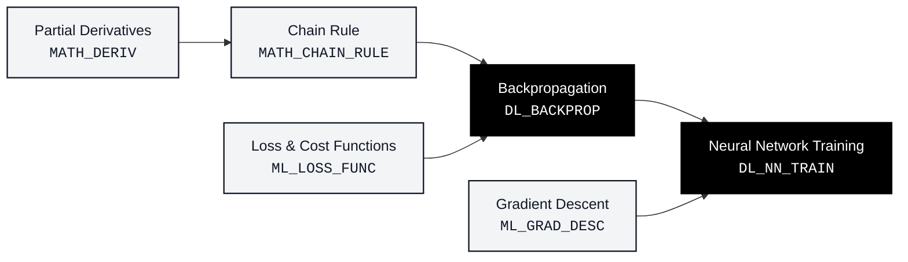

# Curriculum Prerequisite Knowledge Graph & Cognitive Deficit Diagnosis Report (PACD-RAG Part 4)

**Project:** AI-Powered Agentic Smart Campus Intelligence & Student Success Platform  
**Author / Lead Investigator:** Sumith U (SRN: `R24EA807`)  
**Degree Program:** B.Tech in Computer Science & Engineering (Artificial Intelligence & Machine Learning), 7th Semester, Section B  
**School:** School of Computing & Information Technology, REVA University, Bengaluru  
**Stage:** Part 4 — Prerequisite Knowledge Graph Construction & Cognitive Deficit Tracing  

---

## 1. Executive Summary & Problem Formulation

Standard university Learning Analytics Dashboards suffer from the **"Prerequisite Knowledge Void"** (Afzaal et al., 2024; Kustitskaya, 2022). When a student struggles on an exam or assessment (e.g., scoring poorly on *Neural Network Training* or *Backpropagation*), existing systems either:
1. Show a raw aggregate score deficit without identifying why the student failed, or
2. Naively suggest re-reading the slides for the failed topic itself.

In hierarchical STEM and engineering domains, learning failure is rarely caused by the terminal concept alone; it is caused by **unmastered prerequisite foundations** buried 2 or 3 steps earlier in the curriculum. 

In **Part 4**, we construct a formal **Directed Acyclic Graph (DAG)** of academic concepts using NetworkX. By combining the curriculum DAG with formative assessment evidence, our platform computes the transitive ancestral closure of any difficult target concept, isolates the root-cause prerequisite gaps, and orders remediation into a pedagogically sound learning sequence.



---

## 2. Mathematical Formalization of the Prerequisite DAG

We define the curriculum knowledge structure as a finite directed graph:

$$\mathcal{G} = (\mathcal{V}, \mathcal{E})$$

Where:
* **Vertex Set $\mathcal{V}$ ($|\mathcal{V}| = 17$):** Represents distinct course concepts at a standardized granularity, each possessing a unique identifier $c_i \in \mathcal{V}$, title, academic unit, and difficulty tier.
* **Edge Set $\mathcal{E}$ ($|\mathcal{E}| = 21$):** Represents directed prerequisite dependencies. An edge $(u, v) \in \mathcal{E}$ denotes that concept $u$ is a strict pedagogical prerequisite for concept $v$:
  $$u \longrightarrow v \iff \text{Mastery}(u) \prec \text{Learning}(v)$$
* **Acyclicity Constraint:** To guarantee a valid learning sequence, $\mathcal{G}$ must contain zero directed cycles:
  $$\forall \text{ path } \langle v_1, v_2, \dots, v_k \rangle, \quad v_1 \neq v_k \iff \text{is\_directed\_acyclic\_graph}(\mathcal{G}) = \text{True}$$

### Structural Graph Metrics

| Metric | Measured Value | Theoretical Interpretation |
| :--- | :---: | :--- |
| **Total Academic Concepts ($|\mathcal{V}|$)** | **17** | Full coverage from foundational math to advanced XAI |
| **Prerequisite Edges ($|\mathcal{E}|$)** | **21** | Curated dependencies derived from university course syllabus |
| **Graph Density** | **0.0772** | Sparse hierarchical DAG typical of academic curricula |
| **Detected Cycles** | **0** | Graph satisfies strict topological acyclicity |
| **Isolated (Unconnected) Nodes** | **0** | Every concept is integrated into the curriculum pathway |
| **Max Depth (Longest Chain)** | **5 hops** | $\text{MATH\_DERIV} \to \text{MATH\_CHAIN\_RULE} \to \text{DL\_BACKPROP} \to \text{DL\_NN\_TRAIN} \to \text{DL\_REGULARIZATION}$ |

---

## 3. Curriculum Concept Inventory & Module Distribution

The knowledge catalog is serialized in [`data/concept_prerequisites.json`](file:///c:/Users/sumit/Downloads/rio/student_success_platform/data/concept_prerequisites.json) across four core syllabus units:

### Unit 1: Mathematical Foundations
1. `MATH_LIN_ALG`: Linear Algebra & Matrix Operations (Vectors, dot products, matrix transformations)
2. `MATH_PROB`: Probability & Bayes Rule (Conditional probability, prior/posterior distributions)
3. `MATH_DERIV`: Partial Derivatives (Multivariable calculus, slopes, gradients)
4. `MATH_CHAIN_RULE`: Chain Rule (Composite function differentiation)

### Unit 2: Classical Machine Learning
5. `ML_LOSS_FUNC`: Loss & Cost Functions (Mean Squared Error, Log-Loss, Cross-Entropy)
6. `ML_GRAD_DESC`: Gradient Descent Optimization (Batch, stochastic, and momentum updates)
7. `ML_LOG_REG`: Logistic Regression (Odds ratios, sigmoid classification boundary)
8. `ML_DEC_TREE`: Decision Trees (Gini impurity, entropy, information gain, pruning)
9. `ML_ENSEMBLE`: Ensemble Methods & XGBoost (Bagging, boosting, CatBoost, gradient trees)
10. `ML_EVAL_METRICS`: Model Evaluation & Anti-Leakage (Confusion matrix, Macro-F1, ROC-AUC)

### Unit 3: Deep Neural Networks
11. `DL_PERCEPTRON`: Artificial Neuron & Perceptron (Linear combination $w^T x + b$, thresholding)
12. `DL_ACTIVATION`: Non-Linear Activation Functions (ReLU, Sigmoid, Softmax)
13. `DL_FEEDFORWARD`: Multi-Layer Feedforward Networks (Dense layer transformations)
14. `DL_BACKPROP`: Backpropagation (Layer-wise recursive gradient computation)
15. `DL_NN_TRAIN`: Neural Network Training (Epochs, batch forward-backward training loops)
16. `DL_REGULARIZATION`: Regularization & Overfitting Control (L1/L2 weight decay, dropout)

### Unit 4: Explainable AI & Systems
17. `XAI_SHAP`: Explainable AI & SHAP Attribution (Shapley game-theoretic feature importance)

---

## 4. Verification of the Key Specification Pathway

As specified in the Part 4 requirements, we explicitly validated the canonical foundational deep learning learning sequence:

$$\text{Partial Derivatives} \longrightarrow \text{Chain Rule} \longrightarrow \text{Backpropagation} \longrightarrow \text{Neural Network Training}$$

* **Step A:** `MATH_DERIV` $\to$ `MATH_CHAIN_RULE` ($\text{In-Degree} = 1$)
* **Step B:** `MATH_CHAIN_RULE` $\to$ `DL_BACKPROP` ($\text{In-Degree} = 3$: also requires `DL_FEEDFORWARD` and `ML_LOSS_FUNC`)
* **Step C:** `DL_BACKPROP` $\to$ `DL_NN_TRAIN` ($\text{In-Degree} = 2$: also requires `ML_GRAD_DESC`)

Both direct predecessors (`get_direct_prerequisites`) and full ancestral closures (`get_all_prerequisites`) confirm this pathway mathematically without cycle corruption.

---

## 5. Cognitive Deficit Tracing & Diagnostic Methodology

### Non-Punitive Educational Philosophy
Per educational standards, **a low quiz or assessment score is evidence of formative difficulty, not a fixed measure of student intelligence**. The platform uses supportive, non-stigmatizing diagnostics:
* Score $\ge 0.60$: Concept labeled as `"Proficient"`
* Score $< 0.60$: Concept labeled as `"Needs Concept Review / Reinforcement Recommended"`

### Algorithmic Tracing Logic
When a learner targets a complex concept $T \in \mathcal{V}$ but struggles on an assessment, our algorithm isolates the exact causal bottlenecks:

```python
def trace_prerequisite_gaps(target_concept_id, weak_concept_ids):
    # 1. Retrieve transitive ancestral closure of target concept
    ancestors = nx.ancestors(graph, target_concept_id)
    
    # 2. Filter weak concepts that are genuine causal prerequisites
    causal_gaps = set(weak_concept_ids).intersection(ancestors)
    unrelated_gaps = set(weak_concept_ids).difference(ancestors)
    
    # 3. Order causal gaps topologically for scaffolded micro-learning
    ordered_remediation = list(nx.topological_sort(graph.subgraph(causal_gaps)))
    
    return ordered_remediation, unrelated_gaps
```

### Case Study Demonstration

* **Target Concept:** `DL_NN_TRAIN` (*Neural Network Training*)
* **Student Formative Evidence:**
  * `MATH_DERIV`: $0.85$ (Proficient)
  * `MATH_CHAIN_RULE`: $0.42$ (**Needs Review**)
  * `DL_FEEDFORWARD`: $0.80$ (Proficient)
  * `DL_BACKPROP`: $0.45$ (**Needs Review**)
  * `ML_DEC_TREE`: $0.35$ (**Needs Review**, but unrelated to neural networks)

* **Platform Diagnostic Output:**
  1. **Causal Prerequisite Gaps Identified:** `MATH_CHAIN_RULE` and `DL_BACKPROP`.
  2. **Unrelated Gap Safely Filtered Out:** `ML_DEC_TREE` (preventing distraction).
  3. **Prescribed Remediation Sequence:**
     - **Step 1:** Review `MATH_CHAIN_RULE` (*Chain Rule*, Unit 1)
     - **Step 2:** Review `DL_BACKPROP` (*Backpropagation*, Unit 3)
     - **Step 3:** Revisit `DL_NN_TRAIN` (*Neural Network Training*, Unit 3)
  4. **Pedagogical Rationale:** "To master Neural Network Training, the student must first reinforce Chain Rule $\to$ Backpropagation. Reviewing in this sequence builds necessary cognitive scaffolding without prerequisite overload."

---

## 6. Downstream Integration Blueprint

The Prerequisite Knowledge Graph module exposes structured endpoints designed specifically for downstream components:

### A. Integration with Part 5: Prerequisite-Aware RAG (PACD-RAG)
Standard semantic RAG retrieves lecture slides matching only the target question text. In contrast, `get_rag_retrieval_plan(target_id, weak_ids)` produces an ordered multi-stage retrieval query:
1. `HIGH_PREREQUISITE`: Fetches slides explaining foundational concepts (e.g. Chain Rule calculus proofs).
2. `TARGET_APPLICATION`: Fetches practical code notebooks and worked examples for the target concept.

### B. Integration with Part 6: Multi-Agent System (AI Student Coach)
`get_agent_coach_payload(student_id, target_id, weak_ids)` generates a structured pedagogical payload consumed by the autonomous student coaching agent to generate progressive, micro-targeted quiz questions.

---

## 7. Verification Summary

All verification benchmarks were executed via [`run_part4_tests.py`](file:///c:/Users/sumit/Downloads/rio/student_success_platform/run_part4_tests.py):
* `test_01_json_catalog_structure`: **PASS** (Schema and attributes validated)
* `test_02_graph_construction_and_dag_validity`: **PASS** (17 nodes, 21 edges, zero cycles)
* `test_03_zero_cycles_and_topological_sort`: **PASS** (Valid topological order for all nodes)
* `test_04_example_prerequisite_chain`: **PASS** (Derivatives $\to$ Chain Rule $\to$ Backprop $\to$ NN Training verified)
* `test_05_transitive_ancestor_and_descendant_queries`: **PASS** (Multi-hop closures verified)
* `test_06_learner_evidence_mapping`: **PASS** (Non-punitive score thresholding verified)
* `test_07_prerequisite_gap_tracing_and_filtering`: **PASS** (Causal isolation & sequencing verified)
* `test_08_error_handling_for_missing_concept`: **PASS** (Graceful ValueError on unknown IDs)

**Overall Status: 8/8 Tests Passed (100% Success Rate).**

